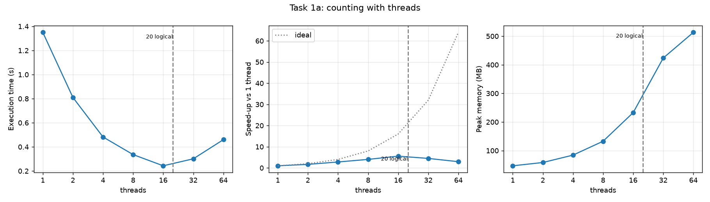
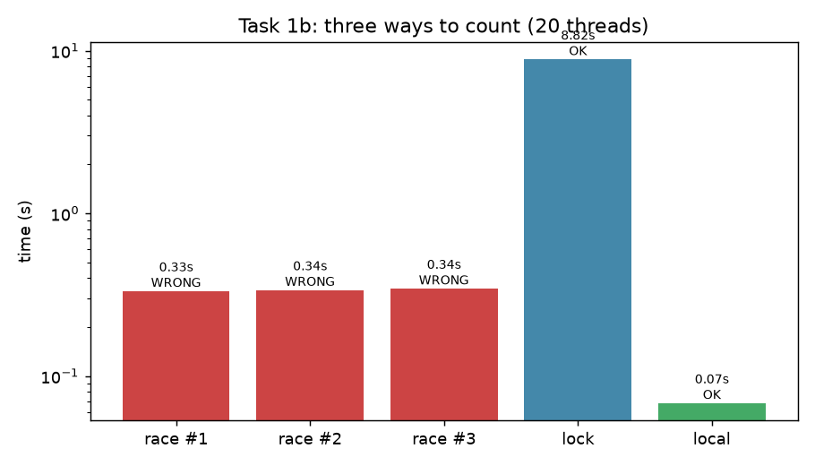
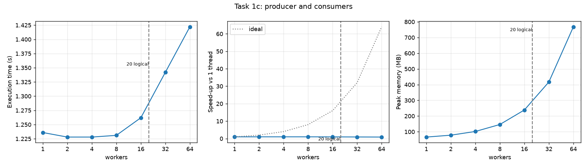
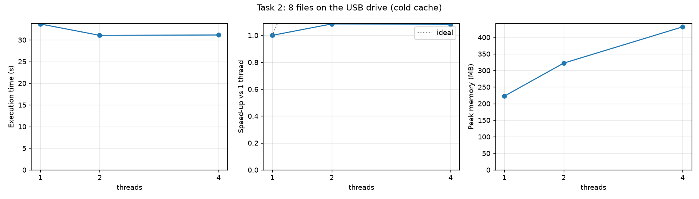

# Laboratory Work 1: Concurrency in Practice

Author: Cătănoi Sergiu

## 1. Source code

https://github.com/mMDSergiu/concurrency-lab1 (single program `Lab1_Cătănoi_Sergiu.js`; build/run instructions in `README.md`, raw results in `results/`).

## 2. Hardware and software

- CPU: 12th Gen Intel Core i7-12700H, 14 physical cores (6 performance cores with Hyper-Threading + 8 efficiency cores), 20 logical processors
- RAM: 15.7 GB
- System disk: Micron MTFDKBA1T0TFH, 1 TB NVMe SSD
- USB drive: "VendorCo ProductCode" flash drive, 124 GB, FAT32, label ESD-USB (D:). Windows does not report the USB version; the measured sequential read speed (about 11 MB/s) is USB 2.0 class or a slow flash chip.
- OS: Windows 11 Pro 10.0.26200 x64
- Language/runtime: JavaScript, Node.js v22.18.0 (V8 12.4), threads are `worker_threads` (real OS threads, each with its own V8 isolate); locks, the queue and shared counters are built on `SharedArrayBuffer` and `Atomics`.

## 3. Method

- `numbers.txt`: 50 000 000 numbers in [-1 000 000, 1 000 000], one per line, 8 files of 6 250 000 numbers for Task 2 (`gen`/`split`/`merge` commands). In every task the result is negative = 25 007 776, positive = 24 992 202, zero = 22, which sums to 50 000 000.
- Execution time includes creating the threads. Peak memory is the maximum resident set size of the whole process (all threads share it).
- Tasks 1a, 1b, 1c: file on the NVMe disk, already in the OS file cache (so they measure CPU, not the disk). One run per configuration, each in a fresh process (`bench` command).
- Task 2: before every run the USB device was disabled and enabled again in Windows (the software equivalent of unplugging and replugging it). I checked that this really empties the cache: a 46 MB file read in 42 ms before the cycle and in 3 888 ms after it. One run per configuration.

## 4. Task 1: one file

| threads | time (s) | speed-up | peak memory (MB) |
|---|---|---|---|
| 1 | 1.350 | 1.00 | 46.9 |
| 2 | 0.810 | 1.67 | 58.4 |
| 4 | 0.482 | 2.80 | 84.2 |
| 8 | 0.336 | 4.02 | 132.7 |
| 16 | 0.243 | 5.56 | 232.7 |
| 32 | 0.301 | 4.49 | 423.7 |
| 64 | 0.460 | 2.93 | 513.2 |

| version (20 threads) | time (s) | negative / positive / zero | correct |
|---|---|---|---|
| shared counters, no sync, run 1 | 0.332 | 4 200 080 / 4 228 221 / 22 (sum 8 428 323) | no |
| shared counters, no sync, run 2 | 0.337 | 4 299 474 / 4 425 622 / 22 (sum 8 725 118) | no |
| shared counters, no sync, run 3 | 0.344 | 4 599 723 / 4 547 773 / 22 (sum 9 147 518) | no |
| shared counters + mutex | 8.819 | 25 007 776 / 24 992 202 / 22 | yes |
| per-thread counters | 0.068 | 25 007 776 / 24 992 202 / 22 | yes |

| workers | time (s) | speed-up | peak memory (MB) |
|---|---|---|---|
| 1 | 1.236 | 1.00 | 66.2 |
| 2 | 1.228 | 1.01 | 78.2 |
| 4 | 1.228 | 1.01 | 101.8 |
| 8 | 1.231 | 1.00 | 146.2 |
| 16 | 1.262 | 0.98 | 238.5 |
| 32 | 1.342 | 0.92 | 416.7 |
| 64 | 1.422 | 0.87 | 767.8 |

### Answers

1. **Where does the speed-up stop?** In Task 1a it grows up to 16 threads (5.56x, 0.243 s) and then falls. It is far from ideal even earlier (4.02x at 8 threads): the machine has 14 physical cores but they are not equal (6 fast P-cores + 8 slower E-cores), two threads on one P-core share its execution units, and all threads share memory bandwidth and the file cache. The maximum is reached at 16 threads, between the 14 physical cores and the 20 logical processors, and it is only 5.6x, not 14x or 20x.
2. **Why do 32 and 64 threads not help?** They are slower than 16 threads (0.301 s and 0.460 s). There are only 20 logical processors, so extra threads cannot run at the same time; they only add cost. Every worker thread in Node.js is a new V8 isolate that must be started (tens of milliseconds each, paid inside the measured time, and 64 of them are created on a 0.24-second job), the operating system has to switch between threads, and each thread has its own 1 MB read buffer and heap, so memory grows from 47 MB to 513 MB while the work stays the same.
3. **Does peak memory depend on the number of threads?** Yes, almost linearly: about 7 MB per extra thread in Task 1a (47 MB with 1 thread, 513 MB with 64). The data are not stored (each thread reads its part through a 1 MB buffer), so the growth is the per-thread cost: a V8 isolate/heap plus the read buffer. In Task 1c the same happens (66 MB to 768 MB), because each worker is also a thread with its own isolate and a copy buffer.
4. **Ranking of Task 1b.** Fastest to slowest: per-thread counters (0.068 s), no synchronisation (0.33-0.34 s), mutex (8.8 s). Only the per-thread counters and the mutex version are correct. Without synchronisation `counter++` is read, add, write; two threads read the same value and both write value+1, so one increment is lost. Here about 80% of the increments were lost, and the totals changed in every run (8.4 M, 8.7 M, 9.1 M instead of 50 M), so the result is wrong and not even repeatable. It is also 5x slower than per-thread counters because all 20 cores keep fighting for the same cache line. The mutex version is correct but 130x slower than per-thread counters, because every number needs a lock and unlock, and the threads wait for each other (the work is practically serial, plus the cost of the synchronisation). The per-thread counters never touch shared memory until the end, so they scale.
5. **Task 1c vs Task 1a.** Task 1a is faster: 0.243 s at best, against 1.23 s. In Task 1c a single reader thread reads the file, finds the line ends and copies every batch into the queue; the workers only parse, which is quick, so they wait for the reader. Task 1c does not get faster at all after 1 worker (1.236 s with 1 worker, 1.228 s with 8), so it stops at 1 worker: the reader is the bottleneck, not the counting. In Task 1a every thread does its own reading and parsing, so all of the work is parallel.
6. **Batches of one line / unlimited queue.** With batches of a single line there would be 50 000 000 queue operations instead of 5 000. Each one takes the lock, may wake another thread (a system call) and makes the threads fight for the lock, so the synchronisation would cost much more than counting one number, and the program would be many times slower than with 10 000-line batches. With a queue without a limit, the reader never has to wait: if it is faster than the workers (for example, with few workers) the queue keeps growing until it holds a large part of the file, and memory use grows with the file size instead of staying about 9 MB (100 batches x 90 KB). On a bigger file the program would run out of memory. The size limit is what gives the back-pressure.

## 5. Task 2: many files on slow storage

| threads | time (s) | speed-up | peak memory (MB) |
|---|---|---|---|
| 1 | 33.687 | 1.00 | 222.3 |
| 2 | 31.057 | 1.08 | 322.1 |
| 4 | 31.139 | 1.08 | 431.6 |

### Answers

1. **CPU-bound or I/O-bound?** I/O-bound. One thread needs 33.7 s on the USB drive, but 1.35 s in Task 1a with the file in the cache of the NVMe disk (a warm run of this same Task 2 code, with the files already cached, took 1.6 s). So the parsing needs about 1.5 s of CPU and the other 32 s, about 95% of the time, the thread waits for the drive. The throughput is 370 MB / 33.7 s = about 11 MB/s, which is the speed of the drive, not of the processor.
2. **Do more threads help?** Almost not: 2 threads give 1.08x (31.1 s) and 4 threads give the same 31.1 s. Lecture 1's example of I/O-bound work that benefits from concurrency is work that waits (for a network server, for example): many requests wait at the same time, and each waiting thread does not use the processor. Here the limit is not waiting time but the **bandwidth** of one device: the USB drive delivers about 11 MB/s in total, no matter how many threads ask for data, so the threads only share the same bandwidth. The only gain (about 2.5 s) is that the short parsing of one file overlaps with the reading of another. More threads also use more memory (222 MB to 432 MB) and give nothing in exchange.

## 6. Conclusion

- **CPU-bound:** Task 1a (counting from a cached file; 5.6x faster with 16 threads, speed-up limited by the physical cores and memory bandwidth), Task 1b (all three versions only compute; time depends on how threads synchronise) and Task 1c, whose time is the time of the single reader thread, so it is limited by one core, not by the number of workers.
- **I/O-bound:** Task 2 on the USB drive. How I know: with the cache emptied, the same parsing code is 25x slower than on a cached file (33.7 s against 1.35 s), the processor is idle for about 95% of the time, the throughput is a constant 11 MB/s, and adding threads changes the time by only 8%.
- Threads help only while there are free processors and the bottleneck is computation (up to about 16 threads here); after that they only cost time and memory. For slow storage, a faster device, not more threads, is what shortens the time.

## 7. Control questions

1. **Physical core and logical processor.** A physical core is a real processing unit; with Hyper-Threading (SMT) it appears to the operating system as two logical processors that share the core's execution units, caches and so on. This machine has 14 physical cores and 20 logical processors (the 6 P-cores have 2 threads each, the 8 E-cores one). It shows in Task 1a: the speed-up is far from ideal already at 8 threads, reaches its maximum between 14 and 20 threads (16) and is only 5.6x; after 20 logical processors it decreases.
2. **No line counted twice or skipped.** A line belongs to the thread whose part contains its first byte. Each thread starts reading one byte early (at s-1) and throws away everything up to and including the first newline (that is the end of the previous thread's line, or the newline right before its part). It stops after the first newline found at or after byte e-1, so it finishes the line that crosses its end, and the next thread skips that line the same way. I tested this against a naive count on a file without a trailing newline with 1 to 200 threads, and the counts were always identical.
3. **Lost updates, step by step.** `counter++` is: (1) read the counter from memory, (2) add 1, (3) write it back. Thread A reads 100. Thread B reads 100. A writes 101. B writes 101. Two increments happened but the counter went up by one. With 20 threads doing this 50 million times, 80% of the increments were lost.
4. **Per-thread counters vs lock.** With a lock only one thread can increment at a time, so the others wait, and every lock/unlock costs atomic operations and cache-line transfers between cores (and system calls when the lock is contended). Per-thread counters are private, need no communication and are added together once at the end. Measured: 0.068 s against 8.8 s.
5. **I/O-bound.** The program spends its time waiting for a device, not computing. For a USB drive, the device itself is slow and has one limited bandwidth (11 MB/s here); the wait cannot be shortened by more threads because there is no more bandwidth to use. For a server waiting for the network, the time is spent waiting for answers (latency) and the network and the remote server can handle many requests at once, so while one thread waits, others can send and receive other requests; more concurrent requests mean more work done per second until the link or the server is full. Concurrency helps when the waiting can overlap, and not when the device is already fully used by one reader.
6. **Equal parts in advance vs queue.** In advance: each thread gets a fixed equal part, with no synchronisation, which is fast when all parts cost the same (Task 1a: 0.24 s). From a queue: threads take the next piece when free, so it balances itself when the pieces take different times or the threads run at different speeds (for example P-cores and E-cores, or lines of different complexity), and it works when the total size is not known, but it costs synchronisation and needs a producer (Task 1c: the reader became the bottleneck).
